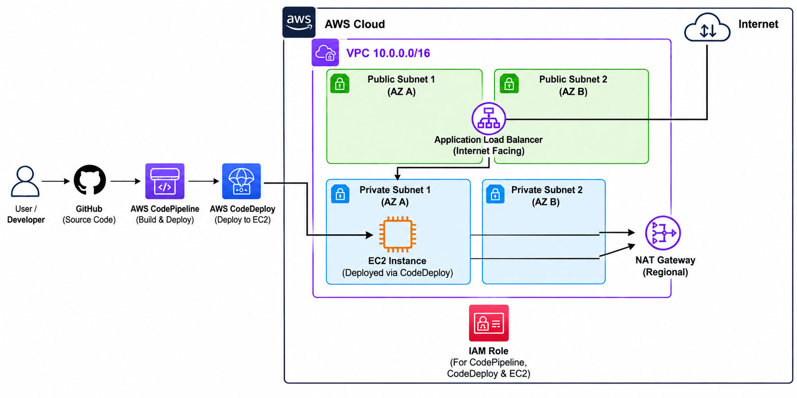
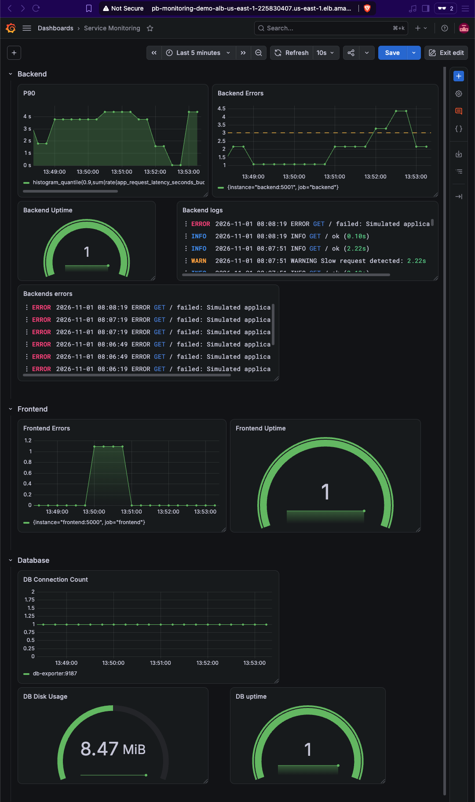
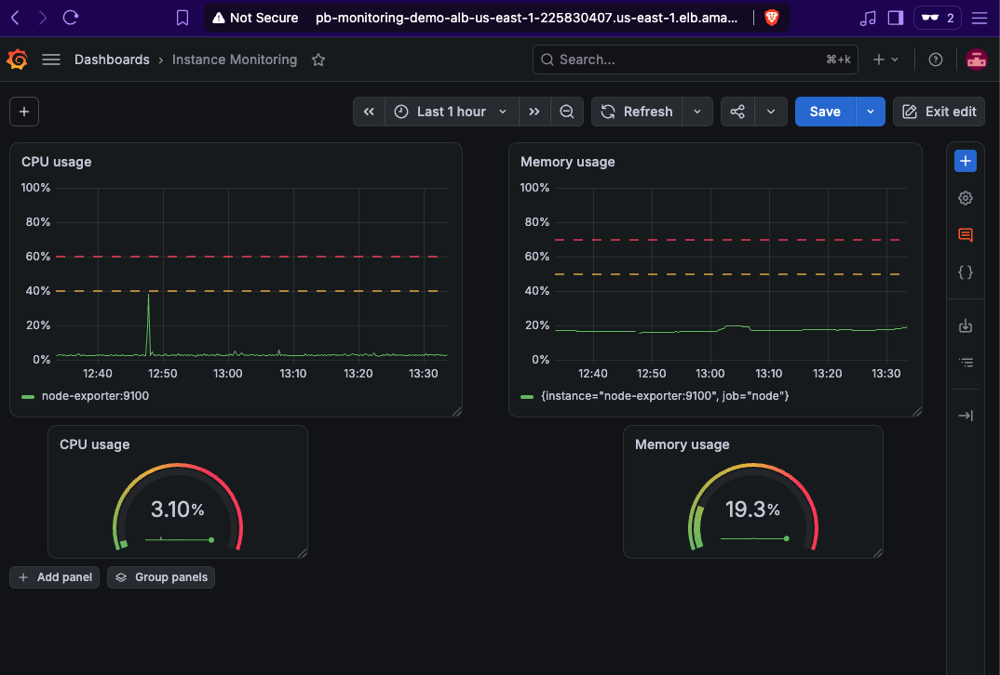

# Loki Prometheus Monitoring and Alerting

## Overview
This repository demonstrates a Docker Compose monitoring stack with:
- Flask `frontend` and `backend` services exposing `/` and Prometheus `/metrics`
- PostgreSQL database with initialization SQL
- Prometheus scrapes application, Postgres exporter, and node exporter
- Alertmanager routing alerts to Slack receivers
- Grafana for visualization and troubleshooting

## Architecture


<br><br>

### 3-tier application Monitoring Architecture
```
        ┌─────────── Docker Compose (EC2) ───────────┐
        │                                            │
 ALB ──►│  grafana ──► prometheus ──► 3-tier-apps    │
        │     │            │  └────► node_exporter   │
        │     │            ▼                         │
        │     │       alertmanager ──► Slack         │
        │     ▼                                      │
        │    loki ◄──────────── backend (logs)       │
        └────────────────────────────────────────────┘
```

- `frontend/`: Flask frontend on port `5050` mapped to container port `5000`
- `backend/`: Flask backend on port `5051` mapped to container port `5001`
- `db/`: PostgreSQL `mydb` on port `5432`
- `prometheus/`: Prometheus configuration and alert rules
- `alertmanager/`: Alertmanager routing rules and Slack receivers
- `grafana`: Grafana dashboard service with admin/admin credentials
- `loki`: Loki collets logs from backend and exposes it at /metrics on port `3100` 
- `scripts/fire_errors.sh`: request generator to produce application errors

## Ports
- `http://localhost:5050` → frontend service
- `http://localhost:5051` → backend service
- `http://localhost:9090` → Prometheus
- `http://localhost:3000` → Grafana
- `http://localhost:9093` → Alertmanager
- `http://localhost:3100/metrics` → Loki
- `http://localhost:9100/metrics` → node exporter
- `http://localhost:9187/metrics` → postgres exporter

## Run the stack
1. Start the stack:
   ```bash
   docker compose up --build
   ```
2. Confirm the services are running:
   - `Frontend` on `http://localhost:5050`
   - `Backend` on `http://localhost:5051`
   - Prometheus on `http://localhost:9090`
   - Grafana on `http://localhost:3000`
   - Alertmanager on `http://localhost:9093`
3. Inspect Prometheus targets at `http://localhost:9090/targets`.
4. Open Grafana and build dashboards or query metrics directly.

## Service behavior
### Frontend service
- Exposes `/` and `/metrics`
- Returns a 500 error roughly 5% of the time
- Uses Prometheus metric: `app_errors_total`

### Backend service
- Exposes `/`, and `/metrics`
- Returns a 500 error roughly 40% of the time
- `/` simulates a slow response with a random 0–3 second delay
- Uses Prometheus metrics:
  - `app_errors_total`
  - `app_request_latency_seconds`

### PostgreSQL
- Container runs Postgres 14
- Credentials: `POSTGRES_USER=root`, `POSTGRES_PASSWORD=root`, `POSTGRES_DB=mydb`
- Initialization script: `db/init.sql`

## Prometheus configuration
`prometheus/prometheus.yml` scrapes:
- `Frontend` on `frontend:5000`
- `Backend` on `backend:5001`
- Postgres exporter on `db-exporter:9187`
- node exporter on `node-exporter:9100`

Alert rules are loaded from `prometheus/alert_rules.yml`.

## Alert rules
- `FrontendErrorRateHigh`
  - `increase(app_errors_total{job="frontend"}[1m]) > 0`
  - fires after 30s
- `BackendErrorRateHigh`
  - `increase(app_errors_total{job="backend"}[1m]) > 3`
  - fires after 30s
- `DatabaseHighConnections`
  - `pg_stat_activity_count{datname="mydb"} > 50`
  - fires after 1m
- `InstanceDown`
  - `up == 0`
  - fires after 30s

## Alertmanager configuration
`alertmanager/alertmanager.yml` routes alerts by severity:
- `severity=warning` → `slack-dev`
- `severity=critical` → `slack-devops`

Slack frontendhook URLs must be provided via environment variables:
- `SLACK_WEBHOOK_URL_devs`
- `SLACK_WEBHOOK_URL_devops`

## Test alert generation
Run the request generator script to produce web and backend traffic:
```bash
./scripts/fire_errors.sh 100
```
This sends requests to both services and exposes intermittent failures which triggers `FrontendErrorRateHigh` and `BackendErrorRateHigh`.


<br><br>


## Grafana Dashboard

<br><br>

**Backend Service Row**
- **P90 Latency**
  - Data-source: `Prometheus`
  - Query: `histogram_quantile(0.9,sum(rate(app_request_latency_seconds_bucket{instance="backend:5001", job="backend"}[1m])) by (le))`
  - Description: Measures the 90th percentile of backend request latency over the past minute, highlighting slowest requests.

- **Backend Errors**
  - Data-source: `Prometheus`
  - Query: `increase(app_errors_total{job="backend"}[1m])`
  - Description: Counts the number of backend errors that occurred in the last minute.

- **Backend Uptime**
  - Data-source: `Prometheus`
  - Query: `up{job="backend"}`
  - Description: Indicates whether the backend service is currently running (1 = up, 0 = down).

- **Backend logs**
  - Data-source: `Loki`
  - Query: `{logger="backend"} |= `\`\`
  - Description: Indicates whether the backend service is currently running (1 = up, 0 = down).

- **Backend errors**
  - Data-source: `Loki`
  - Query: `{severity="error"} |= `\`\`
  - Description: Indicates whether the backend service is currently running (1 = up, 0 = down).

**Frontend Service Row**
- **Frontend Errors**
  - Data-source: `Prometheus`
  - Query: `increase(app_errors_total{job="frontend"}[1m])`
  - Description: Counts the number of web service errors over the past minute.

- **Frontend Uptime**
  - Data-source: `Prometheus`
  - Query: `up{job="frontend"}`
  - Description: Shows if the web service is currently operational (1 = up, 0 = down).

**Database Service Row**
- **Connection Count**
  - Data-source: `Prometheus`
  - Query: `sum by (instance) (pg_stat_activity_count{datname="mydb"})`
  - Description: Displays the total number of active connections to the database "mydb" per instance.

- **DB Uptime**
  - Data-source: `Prometheus`
  - Query: `up{job="postgres"}`
  - Description: Indicates whether the PostgreSQL database service is running (1 = up, 0 = down).

- **Database Disk Usage**
  - Data-source: `Prometheus`
  - Query: `pg_database_size_bytes{datname="mydb"} / (1024*1024)`
  - Description: Shows the size of the database "mydb" in megabytes. 


**Instance/Node Dashboard**


<br><br>

- **CPU Usage**
  - Data-source: `Prometheus`
  - Query: `100 - (avg by (instance) (irate(node_cpu_seconds_total{mode="idle"}[1m])) * 100)`
    - Description: Calculates “CPU usage percentage per server instance”
    - Notes:
      - `rate()` = Calculates the average per-second rate over the whole range window (here range window is 1m)
      - `irate()` = Calculates the rate using only the last two samples regardless of range window

- **Memory Usage**   
  - Data-source: `Prometheus`   
  - Query: `(node_memory_MemTotal_bytes - node_memory_MemAvailable_bytes) / node_memory_MemTotal_bytes * 100`
    - Description: Calculates “memory usage percentage”

## Notes
- Grafana default admin user/password: `admin` / `admin`
- Prometheus rule file: `prometheus/alert_rules.yml`
- Alertmanager config: `alertmanager/alertmanager.yml`
- Use `docker compose down` to stop and remove containers
